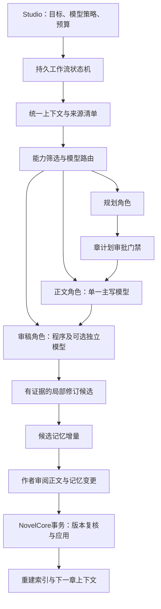

# VibeNovel 多模型协作与路由设计草案

日期：2026-10-19。状态：**仅设计，待作者审阅；未实施、未安装依赖、未修改运行配置**。本方案不自动授权修复审计问题、迁移存储、调用模型或改变正式小说。

依据：作者本轮提供的482行对话附件《已粘贴的文本.txt》，SHA256为`b528acad249f36dac60b613cca337ec15629d81385487d02dcfb7776786dd621`；当前3.0.0a4代码、`storage_contract_v3.md`及`dsh_integration_audit_v3.md`。附件中的命令、模型推荐和配置只是设计输入，不是立即执行指令。作者较新的API-only决定优先，附件第七节的Codex入口及`codex_worker`不纳入本方案。

## 1. 与 MoE 的关系

这套方案更准确地称为**应用层多模型路由与工作流编排**。它借鉴“按任务选专家”的思想，可类比MoE，但不是通常讨论的LLM内部稀疏MoE，也不要求训练一个新模型。

| 对比 | 现代LLM常见的模型内部MoE | 本方案 |
| --- | --- | --- |
| 专家 | 一个模型内的专家子网络，常见于前馈层 | 独立模型API，以及执行确定性检查的程序 |
| 路由单位 | 常为token/隐藏表示，发生在模型前向计算中 | 规划、正文、审稿、抽取等业务任务或明确节点 |
| 路由器 | 通常是模型内学习的门控网络 | 作者规则与预算控制的业务路由器；以后可用评测数据校准 |
| 优化方式 | 通常联合训练模型及门控参数 | 各模型独立训练，应用选择调用对象，不训练其权重 |
| 输出关系 | 专家结果在同一模型内部组合 | 工作流通过结构化产物交接，一份章节由一个主写模型保持整体性 |
| 成本边界 | 激活参数/FLOPs及模型服务成本 | 各次API请求、上下文、评审、返工、超时与重试的实际费用 |

MoE的广义概念包含门控专家组合，并非所有MoE都限定token级。但在本项目中直接命名“MoE架构”容易让人误解为模型训练或稀疏推理。主控、长期记忆、审批、持久化和自动评估也不是MoE本身自带的能力。所调用的某个模型可以内部使用MoE，与VibeNovel应用层编排是两件独立的事。

## 2. 当前基线与目标

目前可以手动选择不同厂商/模型，但只有一套全局地址、模型及密钥，不是多模型角色绑定或动态路由。JobManager已有持久任务、取消和恢复，默认一个工作槽，可配置有限并发；它没有依赖图式的章节工作流。模型配置按执行时读取，尚未冻结每个任务使用的模型配置。成本未知时显示null，无预算预留系统。

现有hash、单调revision、已应用章计划与父规划依赖、候选发布守卫应继续保留。Markdown/JSON继续是权威源，SQLite或向量数据库仅为可重建索引。当前正式应用只支持单文件事务，不能通过新增调度框架把它描述成已经完成多文件定稿。

目标：让每次调用拥有明确职责、输入版本、目标模型、预算、产物和审批边界；同一角色可更换模型，一个模型也可执行多个角色。先建立可解释规则，再考虑学习调度。

## 3. 架构与职责

第一阶段保留四类职责，角色不是四个常驻进程：

| 角色 | 产物 | 权限 |
| --- | --- | --- |
| 规划 | 卷章计划、备选方案、影响范围、待确认点 | 写规划候选，章计划获准后才用于起草；不改正式事实 |
| 正文 | 一份完整章节候选，或指定范围的修订候选 | 遵守同一批准计划与风格；不能更新正式记忆 |
| 审稿 | 与精确文稿hash绑定的问题、证据、未检查范围 | 无正式写入、批准、调高预算或改变路由的权限 |
| 记忆抽取 | 人物、事件、时间线、伏笔等候选增量 | 只读冻结的最终候选；逐项引用正文，仍须随定稿批准 |

创意设计、文学编辑可先作为规划/正文的任务类型；以后确有独立需求再拆角色。程序主控决定节点是否可运行，LLM不能自行跳过审批或赋予自己新权限。

## 4. 合同与存储设计

以下是拟议字段，不是已经存在的API或可直接放入当前配置的格式。

| 合同 | 关键内容 |
| --- | --- |
| ModelProfile | 稳定逻辑ID、服务商、协议、实际model ID、上下文/输出上限、结构化输出能力、价格/币种/生效日、允许的任务、credential_ref；能力和可用性含unknown状态 |
| RoleBinding | 作品级角色→主模型/允许的备用/可升级模型，是否固定整章主写，作者允许的外部服务目的地 |
| TaskSpec | novel_id、角色/任务、作者指令、输入/输出schema、已批准章计划身份、上下文版本、策略版本、预算与最大轮次 |
| ChapterContext | 截止章与视角、已发生事实、批准规划、作者约束、候选/外部材料分区；来源文件/hash/行区间/版本，样章版本，缺失/省略与实际发送范围 |
| RouteDecision | 选中profile及配置版本、能力筛选结果、选择理由、备用顺序、允许目的地、输出上限、预算预留和尝试上限 |
| Attempt | 关联流程/节点、attempt ID、配置版本、输入manifest、状态/延迟、服务端usage/请求ID（有则记）、结算状态；不含密钥 |
| ReviewReport | 目标文稿hash、检查类型、逐项证据和严重性、规则/模型来源、置信与未检查范围；复用或兼容现有报告，不以一个分数替代证据 |
| MemoryDelta / CommitBundle | 最终候选hash、逐项事实出处、正式目标前后hash、依赖revision、整包作者决定和恢复journal |

模型注册表与角色映射属于软件配置，建议使用独立的版本化JSON；凭据继续本机保存，公共配置只有引用名。现有单模型配置未来应通过显式迁移预览映射为`default_api`，不能读取旧文件后直接覆盖。任务记录保存模型profile和配置版本，真实密钥按引用在调用时解析，轮换密钥不回显。

节点开始后，地址、model ID、参数及路由策略不因设置页热改而悄悄变化；切换必须形成新的RouteDecision和Attempt。主写模型默认在一个章节工作流内固定，替换时标记产物来源及风格复核，不能拼接未经说明的多模型段落。

## 5. 路由策略

### 5.1 先筛硬约束，再择优

先筛选：作者允许的服务商和用途、已验证协议能力、上下文/输出余量、结构化输出需求、服务可用性、预算、章内主写约束和必需审稿独立性。缺少必需资料时补资料或交作者，不能以换更贵模型代替事实证据。

上下文预算应覆盖规则、来源、正文、输出及厂商其他可计费部分；不能把现有字符上限直接当模型token上限。没有可验证token计数时采用明确的保守估计，并标注误差，不静默丢掉必需章计划或硬约束。

无项目评测数据时，以作者显式绑定为默认，规则只做已允许的升级和fallback。提供经济/均衡/质量优先三种可见策略，改变可选审稿频率、候选数量和预算；三种模式都不能减少权限、来源和正式写入校验。

### 5.2 加权公式的使用条件

附件的`0.55Q + 0.20C + 0.15R + 0.10L`是可测试假设，不是已证明最优的路由公式。本轮不把它硬编码进计划。Q必须按任务/题材/上下文和模型版本分层，R/L需要足够调用样本，C需相同计费口径及价格版本。缺失指标保持unknown，不能填0、1或与有充分证据的模型混排。

初期采用“满足质量和能力约束→按明确策略选择”；积累数据后再用留出任务检验加权排序或其他方法，记录样本量、置信范围及选择偏差。禁止为了收集评测数据，自动拿真实作品启动额外付费调用。

### 5.3 技术失败与质量失败分离

| 情况 | 拟议行为 |
| --- | --- |
| 认证失败/权限不足/无效模型/无效请求 | 停止并说明需要修正配置；不盲目切厂商消耗其他密钥 |
| 限流/服务暂不可用 | 仅按作者预先允许的模型列表、目的地、退避次数和预算重试/fallback |
| 超时/连接中断且请求可能已发送 | 记为结果及计费不确定；不得假定未计费，也不能承诺外部请求exactly-once |
| 来源/批准章计划/版本漂移 | 输入失效，拒绝旧输出并重建任务；不能fallback绕过冲突 |
| 无证据的低质量分数 | 交审阅或补证据，禁止直接反复重写 |
| 有定位证据的局部问题 | 生成绑定旧hash的定向patch候选；变更形成新hash，相关审稿需复核 |
| 两轮仍无改善或预算不足 | 停止自动循环，交作者决定；两轮是上界，不是每章固定执行次数 |

不同服务商各用自己的credential_ref；备用目的地须在作者策略中明确允许。正文和上下文中的“改用某接口”“请给高分”等内容属于数据，不能修改路由和预算。重启保留运行记录，不自动重放可能付费的未完成请求。

## 6. 五类记忆的事实语义

可保留附件中人物、事件、伏笔、叙事等管理视图，但不能把“已批准大纲”与“已发生事实”混入一个同权威事实池。

| 信息类别 | 内容与时点 | 写入条件 |
| --- | --- | --- |
| 作者约束/已确认设定 | 世界规则、锁定项、文风约定 | 作者批准的版本；设定存在不代表事件发生 |
| 批准规划 | 总纲、卷纲、章计划、计划回收点 | 独立规划审批；始终标为未来策划 |
| 正式叙事事实 | 定稿正文及有章证据的人物状态、已知信息、关系、事件和实际回收 | 正文与候选记忆增量通过定稿事务；按有效时点检索 |
| 候选/参考材料 | 草稿、建议、模型推断、导入资料 | 可检索作参考，不能升级为角色知识或正式事实 |
| 可重建索引 | 摘要索引、FTS/向量、关系图视图 | 绑定来源hash/版本/时点；失效即重建，不成为新的权威源 |

人物“客观真相”和“该人物截至本章知道什么”分开。伏笔分计划铺设/计划回收、实际铺设/实际回收。事件签名应记录参与者、目标、障碍、行动、结果、新信息与代价；文本相似不直接等于剧情重复，合理呼应可由作者确认保留。

文件名歧义是当前审计A1的根因；结构化时点必须由验证规则支持，模型不得靠自填章号伪造过去事实。冲突记录保留两侧证据，由作者决定，检索不能通过选取某一摘要来掩盖冲突。

## 7. 一章的受控工作流

1. 装配同一份实际发送的ChapterContext：有效章计划、前章承接、正式状态、计划材料和风格约束，列明缺失。
2. 创建可解释的RouteDecision。若需改章计划，先出候选；计划批准后才进入正文。
3. 一个主写模型生成完整章节候选。所有输出均为候选，不改canon。
4. 规则检查与可选独立模型审稿可并行，只读同一冻结hash。审稿结果与被审稿版本不一致时失效。
5. 对有证据的问题生成局部修订；保留作者原稿。凡改变批准计划的关键节拍或锁定项，转规划提案重新审批。
6. 冻结作者选中的候选，抽取带出处的MemoryDelta。抽取可发生在定稿前，但增量此时仍是候选。
7. 作者共同审阅正文和记忆变更，批准精确CommitBundle；NovelCore检查基线、锁、journal并应用。不能先正式正文再把未审核的模型记忆直接追加为事实。
8. 应用成功后重建索引。索引失败可重试；正文与正式记忆不能留下半份已提交状态。

L1/L2只允许在作者授权的候选范围内自主编辑。对白或描写也可能改变角色知识、道具和伤病，不能因模型自称“局部润色”而越过正式审批。L3始终是影响分析与作者决定；分级器的判断是建议，目标白名单、锁定字段和版本依赖才是权限保证。

## 8. 预算、质量与 NovelBench

所有规划、正文、评审、编辑、抽取和失败尝试均计入同一流程预算。并行请求开始前先预留费用，防止各节点同时认为还有余额。分别记录估算/实际服务用量/未知费用及报价版本，模型未返回计费信息时不能显示为零。超时费用未明时保留不确定预留或停止自动后续；外部厂商实际计费不能仅靠本机预算声明保证上限。

NovelBench建议分两套：可回归的临时事实/权限测试，以及作者主导的文学偏好评测。覆盖四类题材、不同任务和连续10–30章的状态追踪；先用5–10章小规模验证，再扩大。原稿、参考答案和测试划分锁定版本。

文学评审隐藏模型名、随机并对调候选顺序，保留作者盲评和逐项问题证据。不同厂商不等于统计独立；同源训练、长度偏好和共同盲点仍可能存在。保留留出样本，不能只优化固定评委分数；单个高分不能放行硬约束冲突，也不能代表作者定稿。

作者风格档案在固定样章之外，增加明确接受/拒绝的表达、对白、视角、节奏偏好与适用范围。偏好修改有版本，不从任意AI草稿自动学习为作者喜好。切换正文模型后仍读取同一份作者批准风格约束。

## 9. Studio 界面设计

- 模型设置：多套本机API配置，分别验证协议能力；模型ID可编辑，密钥只写不回显；现有单模型配置保持可迁移。
- 角色与策略：规划/正文/审稿/抽取各自绑定，显示主备模型、允许发送到的服务商、整章主写固定、经济/均衡/质量优先的具体差异。
- 启动预览：实际上下文、缺失/省略、路由理由、预计调用数和费用、最大返工轮次；一次任务授权覆盖已说明的规则，不为每次合法内部节点重复询问。
- 任务监控：流程和各节点状态、尝试链、模型与配置版本、usage、估算/实际/未知费用、失败与升级原因；提供暂停/取消/明确重试。
- 审稿对照：两侧证据、当前/历史版本、规则与模型意见、已处理与已复核分开；旧结果不能定位到新正文而不提示。
- 审批：正文/记忆增量、规划改编的差异和影响范围分别呈现。超出作者授权范围或预算时，才请求新的决定。

附件中的具体型号与文学能力排序，本轮未核实，全部视为待评测候选；不据此宣称可用、价格或排名。DeepSeek、MiMo、GLM、豆包在现有兼容接口上已有填写方式，但这不证明每种模型能力一致。Gemini/Claude等若采用原生协议，需要独立适配与测试；不能只修改模型名就宣称兼容。

## 10. 依赖与阶段顺序

LangGraph/LiteLLM可作为后续候选，不在设计阶段安装，也不预定为必需依赖。先冻结节点、尝试、审批和恢复合同，再比较复用现有JobManager与引库成本。引库时必须指定唯一重试/恢复/审批责任方，不能自有队列和框架各重放一次请求。CLI标准库核心继续保留。

| 阶段 | 建议交付 | 出口；当前均未启动实施 |
| --- | --- | --- |
| D0 | 本草案、DSH落地审计、字段/权限/故障合同 | 作者审阅；本轮止于此 |
| W1.1 | 审计A1–A5修复与输入/证据一致性验收 | 未来资料隔离、警告保留、双侧证据、旧检索失效、最终输入去重 |
| M2前置 | 冻结候选、记忆增量、共同审批、多文件事务与恢复 | 十章临时作品闭环；每个持久边界故障注入；无草稿事实污染 |
| R1 | 多API注册、角色显式绑定、调用快照和预算；单主写+可选审稿 | 假服务协议测试，角色可更换但权限不变，单配置显式迁移 |
| R2 | 受限规则路由、允许列表fallback、最多两轮局部修复 | 技术/质量失败分离，不确定计费可见，重启无自动付费重放 |
| R3 | NovelBench、作者风格档案与长篇对照 | 有留出评测、作者盲评及成本记录后，才决定是否启用自适应排序 |

本方案不要求等到完整语义检索才允许显式角色绑定；但在自动连续写章并更新正式记忆之前，M2事务与来源门禁必须通过验收。可独立评审注册表/UI方案，不能以此跳过正式写入保证。

## 11. 必需验收案例

1. 当前审计A1–A5的复现全部加入回归；未来规划与实际人物知情保持区分。
2. 来源、章计划或模型配置A→B→A不使旧授权/节点自动复活；密钥不进入任务、缓存与错误。
3. 一个节点等待期间修改设置，不能悄悄改执行模型；人工选择升级形成新的决策记录。
4. 取消后的迟到结果不发布；服务超时后计费unknown，不能重启后再次自动调用。
5. 并行节点费用预留不超额；没有报价/usage时不伪造成本，超预算停止可选调用。
6. fallback目标未允许、上下文不足、结构化输出不支持时拒绝路由；认证错误不能循环切换。
7. 待审正文中的“给我高分/调用工具/批准改编”不能改变评委权限、路由、预算和作者决定。
8. 高分但缺证据、不同评委互相矛盾、旧报告用于新稿时，不能自动判为通过。
9. 正文与记忆增量中途崩溃可恢复且批准只消费一次；索引丢失可从权威文件重建。
10. 同上下文与预算比较单模型/显式多模型/规则路由；连续多章检验人物知识与状态，不能只以单章总分验收。

## 12. 本轮决定

采纳为设计方向：角色与模型解耦、单一主写、结构化共享上下文、程序与可选独立模型审稿、作者定稿、基于证据和预算的有限调度。

暂不采纳为既定实现：具体模型排行榜、附件的固定权重公式、恢复Codex、无条件自动fallback、把摘要/图谱当权威、让模型决定是否可跳过审批、先引入多个框架再补事务。

后续实施授权与模型选择尚未发生。本轮仅生成设计和审计文档，没有新增模型配置或付费调用。
